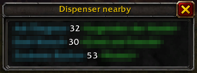
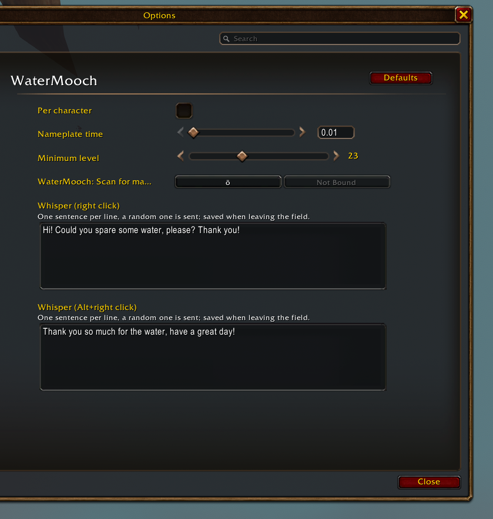

# WaterMooch

On a slash command or key press, WaterMooch lists the mages around you in a small window;
a left click targets the mage and marks them with a blue square, a right click whispers
them your own text, Alt+right click a second one.

## Features

- **Scan on demand** - `/wmooch scan` or your own key binding lists the friendly mages nearby
  (nameplates, group, target, mouseover, and mages seen in the last minute) in a movable
  window, each with level and <guild>.
- **Minimum level** - list only mages from a chosen level up (slider or chat command).
- **Key binding** - set the scan key on the addon's settings page or under Options >
  Keybindings > WaterMooch.
- **Target and mark** - left-click a name to target the mage and set the blue square marker.
- **Whisper** - right-click the name to send your whisper, Alt+right-click to send the
  second one; a left click never whispers.
- **Trade** - Alt+left-click a name to target the mage and open a trade.
- **Own whisper texts** - type both whispers on the settings page Options > AddOns >
  WaterMooch, or set them by chat command.
- **Random sentences** - give each whisper several sentences, one per line; a random one
  is sent each time.
- **Remembered** - settings are saved per account, or per character with one checkbox.
- **Settings page** - the per-character switch, both sliders, the scan key, and the whisper
  texts in the game menu under Options > AddOns, also opened from the addon compartment
  menu.
- **Chat commands** - every option can also be changed by slash command; `reset` restores
  the defaults, `debug on` shows what the addon does.
- **German** - German clients get German texts and default whispers; English otherwise.

A scan switches friendly player nameplates on for a moment (0.5 seconds by default,
adjustable from 0.01 to 3 seconds by slider or number field) when they are off, so mages
nearby are found without hovering or targeting them; your setting is restored right after.
After a disconnect or crash during a scan, it is restored on your next login.

## Screenshots





## Install

1. Download `WaterMooch-vX.Y.Z.zip` from the
   [releases](https://github.com/tf4482/WaterMooch/releases) (or CurseForge, Wago).
2. Unzip it into `World of Warcraft/_forever_/Interface/AddOns/`.
3. Restart the game or type `/reload`.

## Usage

```text
/wmooch                      show the current state
/wmooch scan                 list the mages nearby
/wmooch time <seconds>       how long a scan shows nameplates (0.01 to 3)
/wmooch minlevel <level>     only list mages of this level or higher
/wmooch message "<text>"     set the right click whisper (add --add for one more sentence)
/wmooch altmessage "<text>"  set the Alt+right click whisper (also with --add)
/wmooch character on         use settings for this character only
/wmooch character off        use the account settings again
/wmooch reset                reset the settings to defaults
/wmooch debug on             show what the addon does, until /reload
/wmooch config               open the settings page
/wmooch help                 list all commands
```

## Examples

- In a city, type `/wmooch scan`; mages near you show up in the window; left-click one, then right-click to ask.
- Bind a key under Options > Keybindings > WaterMooch > "Scan for mages" and press it
  whenever you need water.
- Only mages who can conjure good water: `/wmooch minlevel 70`
- Busy city, some mages missing: `/wmooch time 1.5`
- Ask for food with Alt+right click: `/wmooch altmessage "Some mage food, please?"`
- One more random choice: `/wmooch message "Got any water to spare?" --add`
- Change the request: `/wmooch message "Hey, could you open a portal to Stormwind? Tip ready!"`
- Put `/wmooch scan` in a macro to scan from an action bar button.

## Develop

Check the code with [Luacheck](https://github.com/lunarmodules/luacheck) before each commit
(CI runs it on every push):

```text
luacheck .
```

Deploy locally: run `deploy.bat`; it builds `release/WaterMooch-vX.Y.Z.zip` from `VERSION`.

Release: set `VERSION` to `X.Y.Z`, then push an annotated tag `vX.Y.Z`; GitHub Actions
packages the addon with the BigWigs packager and publishes it.

## License

All rights reserved, see [LICENSE](LICENSE).
